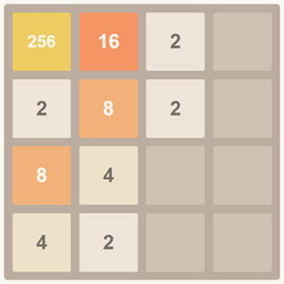

# 2048 Game

<p align="center">
  
</p>

A modern implementation of the 2048 game with smooth animations and a responsive design.

[中文说明/Chinese Documentation](README.md)

## 🎮 About the Game

2048 is a single-player sliding tile puzzle game created by Gabriele Cirulli, an Italian developer, in 2014. The goal is to slide and merge numbered tiles on a 4×4 grid until you create a tile with the value 2048.

This project is a modern web implementation of 2048 that keeps all the fun of the original game while adding a modern UI design, smooth animations, and a number of enhancements. Whether you're on a desktop or a mobile device, you'll enjoy a fluid gaming experience.

## ✨ Features

- 🎮 **Classic Gameplay**: A faithful recreation of the core mechanics of the original 2048 game
- 🌓 **Theme Switching**: Light and dark themes to protect your eyes
- 💾 **Auto Save**: Game progress is saved automatically, so you can pick up where you left off anytime
- ↩️ **Undo**: Undo your last move — everyone deserves a second chance
- 📱 **Fully Responsive**: Responsive design that works great on everything from phones to desktops
- ✨ **Polished Animations**: Smooth merge animations and fade-in effects for new tiles
- 🏆 **Achievements**: Tracks your best score and largest tile to keep you challenged
- 🎯 **Endless Mode**: Keep playing after reaching 2048 and chase even higher numbers
- 🔄 **One-Click Reset**: Start a new game challenge at any time

## 📏 Game Rules

1. The game is played on a 4×4 grid
2. Two numbered tiles (with a value of 2 or 4) appear at random positions at the start
3. The player can slide in four directions (up, down, left, right)
4. On each slide, all tiles move as far as possible in that direction
5. When two tiles with the same number collide, they merge into a single tile with their sum
6. After each move, a new tile (2 or 4) appears at a random empty position
7. When a tile with the value 2048 is created, the player wins
8. If the grid is full and no merges are possible, the game is over

## 🕹 How to Play

### Desktop Controls

| Action | Key |
|------|------|
| Move up | ↑ (Up arrow) |
| Move down | ↓ (Down arrow) |
| Move left | ← (Left arrow) |
| Move right | → (Right arrow) |
| Undo | Ctrl+Z or click the "Undo" button |
| Restart | Click the "New Game" button |
| Switch theme | Click the theme toggle button |

### Mobile Controls

| Action | Gesture |
|------|------|
| Move up | Swipe up |
| Move down | Swipe down |
| Move left | Swipe left |
| Move right | Swipe right |
| Undo | Tap the "Undo" button |
| Restart | Tap the "New Game" button |
| Switch theme | Tap the theme toggle button |

## 🧩 Game Strategy

### Basic Strategy

1. **Keep big numbers in a corner**: Pin your largest numbers in one corner so they don't block the movement of other tiles
2. **Build number chains**: Arrange numbers in descending order so adjacent tiles merge more easily
3. **Stick to two directions**: Choosing two adjacent directions (e.g., up and left) as your primary moves keeps the board more organized
4. **Plan ahead**: Think a few moves ahead instead of just the current one

### Advanced Techniques

1. **Snake strategy**: Arrange numbers along a snake-shaped path, from largest to smallest
2. **Corner tactics**: Always keep your largest number in a fixed corner
3. **Merge chains**: Create sequences of numbers that can merge one after another
4. **Space management**: Keep enough empty cells to have more move options

## 💻 Technical Implementation

### Frontend Technologies

- **HTML5** - Builds the game interface structure
- **CSS3** - Responsive layout and smooth animations
- **JavaScript (ES6+)** - Core game logic
- **LocalStorage** - Local data persistence

### Core Algorithms

- **Tile movement algorithm** - Efficiently handles tile movement and merging
- **Random spawn algorithm** - Smart generation of new numbered tiles
- **Game state detection** - Real-time detection of win and loss conditions

### Performance Optimizations

- **Event delegation** - Reduces the number of event listeners
- **CSS animations** - Uses CSS3 hardware acceleration for better animation performance
- **Debouncing** - Optimizes window resize and touch events
- **Memory management** - Avoids memory leaks and excessive DOM operations

## 📁 Project Structure

```
2048/
├── css/              # Stylesheets
│   └── style.css     # Main stylesheet
├── js/               # JavaScript source code
│   ├── game.js       # Core game logic
│   └── storage.js    # Storage management
├── index.html        # Main game page
└── README.md         # Project documentation
```

## 🚀 Installation & Running

### Play Online

Visit the [game homepage](https://blog.huazie.com/diversity/game/2048/) to start playing right away.

### Run Locally

1. Clone the repository:
   ```bash
   git clone https://github.com/huazie/flea-game.git
   ```

2. Enter the project directory:
   ```bash
   cd flea-game
   ```

3. Open the 2048 game:
   - Windows: double-click the `2048/index.html` file
   - macOS: `open 2048/index.html`
   - Linux: `xdg-open 2048/index.html`

4. Enjoy the game!

## 🌐 Browser Compatibility

| Browser | Support | Minimum Version |
|-------|---------|---------|
| Chrome | ✅ Fully supported | 49+ |
| Firefox | ✅ Fully supported | 52+ |
| Safari | ✅ Fully supported | 10+ |
| Edge | ✅ Fully supported | 79+ |
| Opera | ✅ Fully supported | 36+ |
| Chrome for Mobile | ✅ Fully supported | 49+ |
| Safari for iOS | ✅ Fully supported | 10+ |
| Firefox for Mobile | ✅ Fully supported | 52+ |

## 🛠 Development Notes

### The Game2048 Class

The core game logic is implemented in the `Game2048` class, which mainly covers:

- **Initialization**: Sets up the game board, score, and event listeners
- **Movement logic**: Handles movement and merging in all four directions
- **State management**: Detects whether the game is over or won
- **UI updates**: Refreshes the game interface and score display
- **Animation handling**: Implements smooth movement and merge animations
- **Theme switching**: Handles toggling between light and dark themes

### The GameStorage Class

Data persistence is handled by the `GameStorage` class, which is responsible for:

- **Saving game state**: Saves the current game state to LocalStorage
- **Loading game state**: Loads the previous game state from LocalStorage
- **Managing the high score**: Records and updates the best score
- **Clearing data**: Provides a way to clear saved data

## ❓ FAQ

### How do I get a high score?
Focus on keeping your big numbers in one corner and try to arrange them in descending order. Avoid random moves and stick to a consistent strategy.

### What should I do if the game gets stuck?
If you can't make any moves, use the "Undo" feature to step back. If the game is truly over, click "New Game" to start again.

### Is my game progress saved?
Yes, the game automatically saves your progress. The next time you open it, you can continue where you left off.

### How do I switch themes?
Click the theme toggle button in the top-right corner to switch between light and dark themes.

### Is there a limit to the largest number?
In theory, no. You can keep merging to create bigger numbers like 4096, 8192, and so on, until no more moves are possible.

## 👥 Contributing

All forms of contribution are welcome, including but not limited to:

- Reporting issues and suggestions
- Submitting feature requests
- Code contributions and Pull Requests
- Documentation improvements

Please contribute through GitHub Issues or Pull Requests.

## 📄 License

This project is licensed under the MIT License. See the [LICENSE](../LICENSE) file for details.
