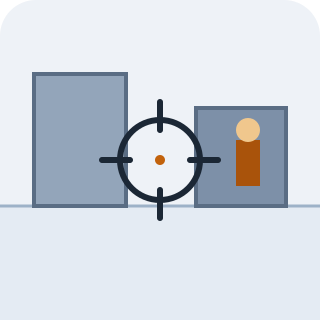

# 反恐突袭

  

一款零依赖的浏览器战术射击小游戏：手写透视投影的 Canvas 2D 软渲染，第一/第三人称一键切换、共用同一套场景与命中射线。3 波清场，靠掩体与精瞄取胜。

[英文说明/English Documentation](README_EN.md)

## 🎮 游戏介绍

在由轴对齐立方体构成的单张地图里，逐波清除本地 AI Bot。画面不使用 WebGL、贴图包或任何 3D 引擎，全部由手写透视投影 + 画家算法绘制的纯色块组成；命中为即时射线（先判墙、再判 Bot），没有飞行弹丸。FPS 与 TPS 只改变相机位置与自身模型显隐，FOV、伤害、散布、射线完全一致——换镜是观察工具，不是强度开关。

## ✨ 功能特点

- 🎯 **hitscan 即时命中**：先判墙 AABB，再判 Bot 公告板矩形，取最近交点；无投射物物理
- 🦘 **跳跃与蹲伏**：Space 跳（初速 4.5 m/s、空中散布 ±12°）、Ctrl/C 按住蹲（眼位 1.60→1.05 m 平滑过渡）；空中/落地/蹲各有散布代价，跳是纯亏手感的战术动作
- 🔭 **一键换镜，同景双读**：V 切 FPS / TPS，共用场景、yaw/pitch 与全部数值，切镜无数值收益
- 🧱 **掩体即战术**：12 块互不相交的墙体遮挡射线；绕侧取视线、掩体后换弹是核心打法
- 🎛 **散布可控**：静止 0° / 蹲移 ±1.0° / 步行 ±3.0° / Shift 稳定归零（移速锁 1.8 m/s），落地 ±10° 于 0.30 s 线性衰减
- 🔫 **换弹是真实窗口**：8 发弹匣、1.4 s 换弹；第 3 波 5 个 Bot 必然触发至少一次换弹
- 🔩 **枪械视图模型**：屏幕空间 5 多边形几何枪，移动 sway / 转视角 lag / 开火后坐与 +1.2° 真实视角上踢 / 换弹动画与枪口火光，不占 3D 面池
- 🎨 **渲染升级**：4 种程序化纹理（砖墙/混凝土/木箱/地面，×2 主题缓存）+ 伪光照 + 距离雾 + 天空渐变；实测 <45 fps 自动降级纯色块渲染
- 💥 **特效与音效**：弹孔贴花（FIFO 32）/ 命中粒子（池 64）/ 抛壳（池 8）/ 枪口火光全预分配；cs 内独立 WebAudio 小合成器（射击/脚步/跳/落地/命中等），零音频文件
- 🤖 **低开销 Bot**：巡逻 → 取得视线停步开火 → 失视线 2 s 重选巡逻点；每帧最多 2 个 Bot 同时开火
- 🌗 **主题联动**：跟随站点明暗主题，画布取色由 CSS 变量读取并缓存，切换即时刷新
- 📱 **全端适配**：PC 键鼠 + Pointer Lock；移动端虚拟摇杆 + 拖拽转视角 + 按住开火 + 跳/蹲钮，低端机降渲染分辨率
- 💾 **成绩记录**：Score = 100×击杀 + 10×命中弹，最高分写入 localStorage

## 🎯 游戏玩法

1. **胜负**：3 波 Bot（3 / 4 / 5 个）全部歼灭 = 任务完成；玩家 HP ≤ 0 = 任务失败。
2. **波间整备**：本波清场后 2.0 s，自动补满弹匣、回复 +20 HP（上限 100），**不重置位置**。
3. **数值**：玩家 100 HP，每发 40 伤害；Bot 80 HP（2 发击杀），每发 8 伤害，开火间隔 1.2 s，命中率随波 0.35 / 0.45 / 0.55。
4. **视线**：Bot 只有在「无墙遮挡 + 距离 ≤ 18 m + 处于 120° 视锥内」时才停步开火。
5. **边缘处理**：空仓不发射、弹药闪红并自动换弹；换弹期间重复输入不排队；失焦 / 切后台 / 丢失鼠标锁自动暂停并冻结计时；TPS 相机遇墙沿后退方向回缩（最短 0.3 m）且近墙时自身模型半透明。

## 🕹 控制方式

### 键盘 / 鼠标

| 输入 | 功能 |
|------|------|
| W / A / S / D | 相对相机 yaw 的前 / 左 / 后 / 右移动 |
| 鼠标移动 | 转 yaw / pitch（点击画面请求 Pointer Lock，pitch 限 ±60°） |
| 左键按住 | 射击，0.20 s 射击间隔（每发 +1.2° 视角上踢，可下拉补偿） |
| Space | 跳（蹲跳 ×0.85；空中散布 ±12°，Shift 空中无效） |
| Ctrl / C 按住 | 蹲：移速 2.0 m/s、眼位 1.60→1.05 m 平滑 0.15 s（推荐用 C，Ctrl+W 关标签无法拦截） |
| R | 换弹（弹匣已满忽略；跳中换弹允许且计时继续） |
| V | 切 FPS / TPS |
| Shift 按住 | 稳定瞄准：移速锁 1.8 m/s、散布强制 0° |
| P / Esc | 暂停 / 继续 |

### 触摸

| 控件 | 功能 |
|------|------|
| 左下虚拟摇杆 | 移动（半径 48 逻辑像素，归中即静止零散布） |
| 右半屏拖拽 | 转 yaw / pitch |
| 右下「开火」 | 按住连发 |
| 「跳」钮 | 开火钮上方，直径 44 逻辑像素 |
| 「蹲」钮 | 跳钮左侧，切换式（再点一次站起） |
| 「换弹」「换镜」「暂停」小钮 | 对应操作 |

暂停后必须主动点「继续」才会恢复（PC 会重新锁定鼠标），不会用累计大 dt 补算。

## 🔧 技术实现

- 纯 Canvas 2D 手写透视投影：相机基向量 → 相机空间 → **0.1 m 近裁剪面**（Sutherland-Hodgman 裁剪）→ 透视除法
- 画家算法按面中心到相机距离降序绘制；逐帧可见面 ≤ 80，面池 / 顶点缓冲 / 排序索引全部预分配，逐帧零对象分配
- 渲染器抽象 `Renderer{beginFrame, submitFace, drawBillboard, drawViewmodel, endFrame}` 接口：`Renderer2D`（程序化纹理 + 伪光照 + 距离雾 + 天空渐变）与 `Renderer2DFlat`（纯色块降级，<45 fps 自动切换）同接口可替换
- 玩家引入 y 轴：跳跃初速 4.5 m/s / 重力 12 m/s²，眼位随跳/蹲动态变化，命中射线固定从实际眼位发出、与相机位完全解耦；跳/蹲不改 x/z 碰撞
- 所有计时用累计 dt（上限 0.05 s），与刷新率无关；暂停 / 失焦停帧
- 移动碰撞为圆 r=0.4 m vs AABB 的轴分离滑动；普通 `<script>` 顺序加载、全局命名空间 `CS` 隔离，无构建步骤、无 ES module、无运行时依赖

更多决策见 [架构 ADR](docs/architecture.md)。

## 🌐 浏览器兼容

支持所有现代浏览器（Chrome / Firefox / Safari / Edge）。需要 Pointer Lock 的桌面浏览器体验最佳；移动端自动切换为触控方案。
