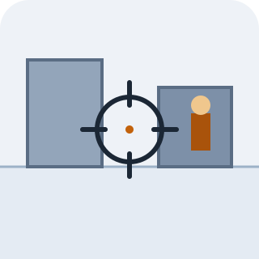

# Counter Assault (反恐突袭)

  

A zero-dependency browser tactical shooter: hand-written perspective projection on Canvas 2D, with one-key first/third-person switching over a shared scene and a shared hitscan ray. Clear three waves; win through cover and precise aiming.

[中文说明/Chinese Documentation](README.md)

## 🎮 About the Game

Clear waves of local AI bots in a single map built from axis-aligned boxes. There is no WebGL, no texture pack and no 3D engine — everything is flat color polygons drawn with a hand-written perspective projection and the painter's algorithm. Hits are resolved by an instant ray (walls first, then bots); there are no travelling projectiles. FPS and TPS differ only in camera position and the visibility of your own model: FOV, damage, spread and the ray itself are identical, so switching views is an observation tool, not a power switch.

## ✨ Features

- 🎯 **Instant hitscan**: nearest wall AABB first, then bot billboard rectangles — no projectile physics
- 🦘 **Jump & crouch**: Space to jump (4.5 m/s take-off, ±12° air spread), hold Ctrl/C to crouch (eye height eases 1.60→1.05 m); air / landing / crouch each carry a spread cost, so jumping is a purely tactical loss
- 🔭 **One-key view switch, one shared scene**: V toggles FPS / TPS (or tap the top-left view·FPS badge) with shared geometry, yaw/pitch and all numbers — zero advantage from switching
- 🧱 **Cover is the tactic**: 12 non-intersecting walls block rays; 4 perimeter walls are full height while 8 interior boxes are waist-high — hug a low box and crouch (eye 1.05 < cover 1.30 m) to break enemy line of sight, then stand (1.60 > cover) to fire back over it; flanking for line of sight and reloading behind cover matter
- 🎛 **Controllable spread**: 0° stationary / ±1.0° crouch-walking / ±3.0° walking & sprinting / 0° with right-button aim (movement capped at 1.8 m/s); landing adds ±10° decaying linearly over 0.30 s; Shift sprints at 6.0 m/s as a mobility trade-off
- 🔫 **Reload is a real window**: 8-round magazine, 1.4 s reload; wave 3 (5 bots) forces at least one reload
- 🔩 **Weapon viewmodel**: a screen-space M4-style layered geometric gun (barrel + muzzle brake, handguard with rail teeth and vent slots, receiver + ejection port, red-dot sight, curved magazine, trigger guard, grip; shading via the `--cs-gun-hi/lo` palette variables) with movement sway, look lag, recoil with a real +1.2° view kick, a reload animation and muzzle flash; on fire the muzzle turns toward the crosshair and eases back when firing stops; the TPS character carries the gun in sync — zero face-pool usage
- 🧍 **MC-style blocky characters**: bots and the player are procedural Minecraft-style blocky figures (segmented head / torso / limbs, enemy face with eyes / nose / mouth, player headband on the back of the head), with visible enemy weapons; the TPS player's back is built from **3D-style boxes** — torso / legs / head each carry a top and right-side face with three light/dark tones derived per theme (volume survives the flat-color fallback), gait and airborne tuck still apply; crouching lowers the whole body in sync with the eye height and bends the knees forward, smoothly blending between stances; hitboxes and accuracy are unchanged
- 🧱 **Walls always solid (TPS)**: walls never turn transparent — no seeing through them; the camera retracts when hugging a wall (minimum 0.3 m) to avoid clipping. All occlusion stays true near-blocks-far
- 🎨 **Render upgrade**: 4 procedural textures (brick / concrete / crate / ground, cached per theme) + fake lighting + distance fog + sky gradient; below 45 fps it steps down automatically (first internal resolution, then flat shading) and steps back up once performance stays healthy (toast notice on every change)
- 💥 **Effects & audio**: bullet-hole decals (FIFO 32), hit particles (pool 64), ejected shells (pool 8) and muzzle flash, all pre-allocated; an in-game WebAudio mini-synthesizer (shot / footstep / jump / landing / hits), zero audio files
- 🤖 **Cheap bot FSM**: patrol → acquire sight, stop and fire → re-pick a waypoint after 2 s without sight; at most 2 bots fire simultaneously
- 🌗 **Theme sync**: follows the site light/dark theme; canvas colors are read from CSS variables, cached, and refreshed on theme change
- 📱 **Full-device support**: PC mouse + Pointer Lock; mobile joystick + drag-to-look + hold-to-fire + jump/crouch buttons, with internal resolution ×0.8 on low-end devices; the help panel is device-filtered — PC shows only keyboard/mouse controls, touch devices only touch controls (same `pointer: coarse` criterion as `CS.Input.isTouch`); the menu "Button Layout · Setup" lets touch players **reposition and resize the touch controls** (drag to place + stepped scaling 70%–160%, persisted in `localStorage.cs_touch`; the pause button stays fixed to avoid lockouts; the entry is hidden on PC; tapping it requests fullscreen + landscape lock within the gesture so the **editor renders in landscape**, matching the actual play view); default joystick 128 px / fire 76 px, inset from the corners for easier thumb reach; on phones the HUD moves fully to the top — row one HP left / ammo right, row two view·FPS left / WAVE center / SCORE right (merged into a single row in landscape with WAVE back on the top edge); the view badge and measured FPS readout are merged into one block (e.g. `FPS · 60`); the **Aim Scope button sits bottom-right above Reload** (tap to toggle and keep aiming, tap again to cancel; right mouse still hold-to-aim); **tap the top-left view·FPS badge to switch FPS/TPS** (also available as the menu "Starting View" and the V key); pause button fixed top-right, all clear of the joystick/fire thumb zones; the site share/comment FABs are **shown only on the main menu** — hidden on every subpage (playing, pause, result, help, layout editor), on all devices
- 📱 **Phone landscape**: entering a mission requests fullscreen and locks landscape (Android Chrome); browsers that cannot lock show a rotate prompt while in portrait and auto-pause, then auto-resume once the device is turned, with a "Skip" escape hatch to keep playing in portrait; PC and tablets are untouched
- 📲 **Add to Home Screen (PWA)**: use the browser menu's "Add to Home Screen", then launch from the icon for a fullscreen, address-bar-free view. On **Android** the manifest's `orientation: landscape` enters landscape automatically — **no need to disable the system portrait lock every time**; **iPhone** cannot force landscape from a web page and still requires system rotation to be allowed (turn the portrait lock off once and it stays off) — the PWA only adds fullscreen and one-tap access; installation requires HTTPS (this site qualifies)
- 💾 **Score record**: Score = 100 × kills + 10 × hits; high score saved to localStorage

## 🎯 How to Play

1. **Win / lose**: destroy all bots across 3 waves (3 / 4 / 5) to complete the mission; HP ≤ 0 means failure.
2. **Between waves**: a 2.0 s intermission refills the magazine and restores +20 HP (cap 100); your position is **not** reset.
3. **Numbers**: player 100 HP, 40 damage per shot; bots 80 HP (2 shots), 8 damage per hit, 1.2 s fire interval, accuracy 0.35 / 0.45 / 0.55 by wave.
4. **Line of sight**: a bot only stops and fires when there is no wall in the way, distance ≤ 18 m, and the player is inside its 120° view cone.
5. **Edge cases**: an empty magazine does not fire or consume ammo, flashes red and auto-reloads; repeated inputs during reload are not queued; blur / background / Pointer Lock loss auto-pauses and freezes timing; the TPS camera retracts along its backward ray when a wall is near (minimum 0.3 m), and walls stay solid with no see-through.

## 🕹 Controls

### Keyboard / Mouse

| Input | Action |
|------|------|
| W / A / S / D | Move forward / left / back / right relative to camera yaw |
| Mouse move | Rotate yaw / pitch (click the canvas to request Pointer Lock; pitch clamped to ±60°) |
| Hold left button | Fire, limited by the 0.20 s interval (each shot kicks the view up +1.2°, pull down to compensate) |
| Hold right button | Aim: movement capped at 1.8 m/s and spread forced to 0° (ignored mid-air) |
| Space | Jump (×0.85 while crouched; ±12° air spread, aim/sprint are ignored mid-air) |
| Hold Ctrl / C | Crouch: 2.0 m/s movement, eye height eases 1.60→1.05 m over 0.15 s (C is recommended — Ctrl+W closing the tab cannot be intercepted) |
| R | Reload (ignored when the magazine is full; reloading mid-jump is allowed and keeps timing) |
| V | Toggle FPS / TPS |
| Hold Shift | Sprint: 6.0 m/s movement while walking spread stays ±3.0°; aim/crouch take priority |
| P / Esc | Pause / resume |

### Touch

| Control | Action |
|------|------|
| Bottom-left joystick | Move (132 logical px base, 48 px full-speed radius unchanged; centered means stationary and zero spread) |
| Drag on right half | Rotate yaw / pitch |
| Bottom-right "Fire" | Hold to fire continuously |
| "Fire" above-right of the joystick | For three-finger play: left index holds fire, independent of the right-hand fire button |
| "Jump" button | Above the fire button, 44 logical px |
| "Crouch" button | Left of the jump button, toggle-style (tap again to stand) |
| Bottom-right "Aim Scope" | Tap to toggle and keep aiming, tap again to cancel (movement capped at 1.8 m/s, spread 0°), above Reload; PC right mouse still hold-to-aim |
| Top-left "FPS / TPS" badge | Tap to switch first/third person (PC also: V) |
| Reload / Pause | Small buttons |

After pausing you must actively press "Continue" (which re-locks the mouse on PC); no accumulated large dt is replayed.

## 🔧 Technical Implementation

- Pure Canvas 2D hand-written perspective: camera basis → camera space → **0.1 m near clip plane** (Sutherland-Hodgman clipping) → perspective divide
- Painter's algorithm sorts faces by distance from the camera to face center, descending; ≤ 80 visible faces per frame, with pre-allocated face pool, vertex buffers and sort indices — zero per-frame object allocation
- Renderer abstraction `Renderer{beginFrame, submitFace, drawBillboard, drawViewmodel, endFrame}`: `Renderer2D` (procedural textures + fake lighting + distance fog + sky gradient) and `Renderer2DFlat` (flat-color fallback, auto-switched below 45 fps) share the same interface
- The player has a y-axis: 4.5 m/s jump take-off, 12 m/s² gravity, eye height varies with jump/crouch while the hit ray always starts from the actual eye position, fully decoupled from the camera; jump/crouch never change x/z collision
- All timers use accumulated dt (capped at 0.05 s), independent of refresh rate; frames stop while paused or unfocused, with no catch-up. A 1 s window below 45 fps steps the quality down one level; 6 s of sustained ≥55 fps without jitter steps it back up (10 fps hysteresis band)
- **Frame pacing**: frame debounce — rAF ticks closer than 8 ms are skipped (dt accumulates naturally), letting 60/75/90/120 Hz displays run at their native refresh rate (the old 15 ms threshold misjudged every 90 Hz (11.1 ms) / 75 Hz (13.3 ms) frame as "too fast" and skipped it, halving 90 Hz to 45 fps and 75 Hz to 38 fps — the root cause of phone stutter); the measured FPS readout is merged with the view badge into one HUD block (0.5 s window); slow-frame adaption (reversible): below 45 fps first drops internal resolution 0.8→0.65 (toast notice), then falls to `Renderer2DFlat` if still insufficient; 6 s of ≥55 fps without jitter steps back up one level (10 fps hysteresis band against flip-flopping); giscus comments are lazy-loaded (initialized on first result / return to menu / 5 s idle in the menu — never competing for the main thread during play)
- Movement collision is a circle r=0.4 m against AABBs with axis-separated sliding; plain ordered `<script>` tags, isolated `CS` global namespace, no build step, no ES modules, no runtime dependencies

See the [architecture ADR](docs/architecture.md) for decisions.

## 🌐 Browser Compatibility

Works in all modern browsers (Chrome / Firefox / Safari / Edge). Desktop browsers with Pointer Lock give the best experience; mobile automatically falls back to touch controls.
