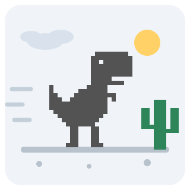

# 恐龙快跑 (Dino Run)

  

一款致敬 Chrome 断网彩蛋的像素恐龙跑酷游戏，使用现代 Web 技术实现。操控小恐龙跳过仙人掌、躲开翼龙，速度会越来越快，看你能跑多远！

[英文说明/English Documentation](README_EN.md)

## 🎮 游戏介绍

恐龙快跑复刻了 Google Chrome 浏览器著名的离线小游戏（T-Rex Runner）的核心手感：像素小恐龙在沙漠中无尽奔跑，玩家通过跳跃与蹲伏躲避障碍。游戏采用与 Chromium 原版一致的物理常数与公平性规则，保证"原汁原味"的跑酷体验。

## ✨ 功能特点

- 🦖 **原版手感**：对标 Chromium 原版物理常数（重力、跳跃初速、速度曲线、间距规则），跳跃满高
- 🌓 **昼夜交替**：每 700 分进入夜晚模式（反色 + 月亮星星），12 秒后恢复
- 🎯 **公平生成**：开局 3 秒空跑道；障碍间距随速度放大；同类型障碍不连续出现超过 2 次；翼龙仅在高速后出现
- 💾 **成绩记录**：最高分按难度分别保存，挑战自我
- 🎚️ **三档难度**：简单 / 普通 / 困难，起始速度与加速度不同
- 🔊 **合成音效**：WebAudio 实时合成的跳跃/得分/死亡音效，可一键静音
- 📱 **全端适配**：PC 键鼠 + 移动端触摸（点击跳、下滑蹲、蹲伏按钮），320px 小屏到横屏全覆盖
- ⏸️ **随时暂停**：P 键或失焦自动暂停
- 🎨 **主题联动**：跟随站点明暗主题，画布取色自动切换

## 🎯 游戏玩法

1. **基本规则**：
   - 恐龙自动向前奔跑，速度随时间逐渐加快（6 → 13 px/帧，约两分钟后到达上限）
   - 撞到仙人掌或翼龙即游戏结束
   - 没有终点，比的是坚持的时间与距离

2. **障碍类型**：
   - 小仙人掌：1~3 株一簇，跳跃躲避
   - 大仙人掌：高速后出现，跳跃躲避
   - 翼龙：高速后出现，三个高度——低位（跳）、中位（蹲或跳）、高位（站立可直接通过）

3. **得分系统**：
   - 分数 = 奔跑距离 × 0.025
   - 每 100 分分数闪烁并蜂鸣提示
   - 最高分自动保存（按难度分别记录）

## 🕹 控制方式

### 键盘控制

| 按键 | 功能 |
|------|------|
| 空格 / ↑ / W | 开始 / 跳跃 |
| ↓ / S | 蹲伏（按住保持低身） |
| P | 暂停 / 继续 |
| 游戏结束按空格 | 立即重来 |

### 触摸控制

| 操作 | 功能 |
|------|------|
| 点击画面 | 开始 / 跳跃 |
| 画布下滑 | 蹲伏 |
| 蹲伏按钮 | 按住蹲伏，松开恢复 |

## 🔧 技术实现

- 纯 Canvas 2D 渲染，精灵由像素矩阵代码绘制（零外部素材）
- delta-time 驱动（60FPS 基准），高刷新率设备速度一致
- 多碰撞盒判定（恐龙三盒 + 障碍单盒，贴合轮廓的"原谅式"判定）
- 逻辑画布 760×220，按容器宽度等比缩放，适配任意屏幕
- 物理参数对标 Chromium 原版：重力 0.6、跳跃初速 -10（随速度微调）、间距系数 0.6、夜晚间隔 700 分 / 12 秒

## 🌐 浏览器兼容

支持所有现代浏览器（Chrome / Firefox / Safari / Edge），移动端与桌面端均可流畅运行。
