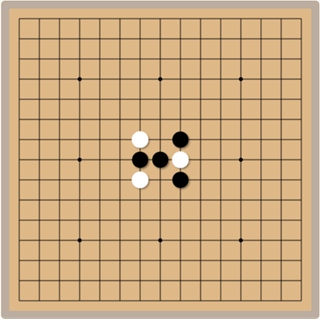

# Gomoku (Five in a Row)

<p align="center">
  
</p>

<p align="center">
  A classic strategy board game that tests your tactical thinking and foresight.
  <br>Black and white stones in turn, five in a row — experience the charm of ancient Eastern wisdom.
</p>

[中文说明/Chinese Documentation](README.md)

## 🎮 About the Game

Gomoku, also known as Five in a Row, is a traditional black-and-white board game that originated in ancient China, with a history tracing back to the Tang Dynasty. Its rules are simple yet the strategy is profound, making it one of the most popular board games in the world.

In Japan, the game is called "五目並べ" (Gomoku Narabe); in Korea, it is called "오목" (Omok); and in Western countries it is also known as "Five in a Row". It has grown into an international mind-sport with professional matches and tournaments.

This project is a modern web implementation of Gomoku that preserves all the charm of the traditional game while adding a modern UI design, smooth animations, and a number of enhancements, including free play and human-vs-AI modes.

## 📏 Game Rules

### Basic Rules

1. **Objective**: The first player to line up five or more stones of their own color horizontally, vertically, or diagonally wins.

2. **Game Setup**:
   - The board is a 15×15 grid (225 intersections in total)
   - Black moves first, and the two players take turns
   - Stones can only be placed on empty intersections
   - Once placed, a stone cannot be moved or removed

3. **Winning and Drawing**:
   - A player wins by lining up five or more stones horizontally, vertically, or diagonally
   - If the board fills up with neither side completing a line of five, the game is a draw (rare)

## ✨ Features

- 🎮 **Classic Gomoku gameplay**: Standard 15×15 board, black and white taking turns, five in a row to win
- 🤖 **Game modes**: Human vs. AI and two-player mode
- 🎨 **Beautiful visual design**: High-definition board and stones with smooth stone-placement animations
- 🌓 **Theme switching**: Light and dark themes that follow the system automatically
- 👆 **Enhanced user experience**: Ghost-stone preview on hover and a marker for the last move
- 📱 **Full device support**: Responsive design, touch-screen optimized, keyboard controls supported
- 🏆 **Game statistics**: Win-rate statistics for both black and white

## 🚀 Installation & Running

### Play Online

Visit the [game homepage](https://blog.huazie.com/diversity/game/gomoku/) to start playing right away.

### Run Locally

1. Clone the repository: `git clone https://github.com/huazie/flea-game.git`
2. Enter the project directory: `cd flea-game`
3. Open the Gomoku game: double-click the `gomoku/index.html` file
4. Enjoy the game!

## 🎯 Controls

- **New Game button**: Start a new match
- **Mode selection**: Switch between human vs. AI and two-player mode
- **Difficulty selection**: Adjust the AI difficulty (Easy / Medium / Hard)
- **Theme switching**: Toggle between light and dark themes
- **Undo button**: Undo the last move (can be disabled in settings)
- **History**: Review past matches
- **Settings menu**: Adjust game parameters

## 🧠 Game Strategy

### Basic Strategy

1. **Control the center**: Try to occupy the center of the board, which offers more line-building possibilities
2. **Balance attack and defense**: Build your own lines while blocking your opponent's
3. **Create multiple threats**: Build lines in several directions at the same time
4. **Recognize basic shapes**: Open three (a line of three open at both ends) and open four (a line of four open at both ends)

### Advanced Techniques

1. **Shape combinations**: Build an open three and an open four simultaneously to create a "four-three" win
2. **Position value assessment**: Analyze the attacking and defensive value of every empty intersection
3. **Reading the position**: Evaluate the overall situation and switch between attack and defense at the right time
4. **Psychological tactics**: Set traps to lure your opponent in, and feint threats to split their attention
5. **Opening patterns**: Classic openings such as Tengen, Star, and Flower Month

## 💻 Technical Implementation

### Frontend Technologies

- **HTML5** - Builds the game interface structure
- **CSS3** - Responsive layout and animation effects
- **JavaScript (ES6+)** - Core game logic
- **Canvas API** - Renders the board and stones

### Core Algorithms

- **Win detection algorithm** - Efficiently detects five in a row
- **AI decision algorithm** - Based on MinMax with Alpha-Beta pruning
- **Position evaluation function** - Evaluates board states and finds the best move
- **Pattern recognition** - Identifies key shapes such as open threes and open fours

### Performance Optimizations

- **Canvas optimization** - Reduces the number of redraws
- **Event delegation** - Reduces the number of event listeners
- **Computation caching** - Caches results of repeated calculations
- **Asynchronous processing** - AI decisions run in a Web Worker to avoid blocking the UI

## 📁 Project Structure

```
gomoku/
├── css/              # Stylesheets
├── js/               # JavaScript source code
├── assets/           # Game image resources
├── index.html        # Main game page
└── README.md         # Project documentation
```

## 🌐 Browser Compatibility

| Browser | Support | Minimum Version |
|-------|---------|---------|
| Chrome | ✅ Fully supported | 49+ |
| Firefox | ✅ Fully supported | 52+ |
| Safari | ✅ Fully supported | 10+ |
| Edge | ✅ Fully supported | 79+ |
| Opera | ✅ Fully supported | 36+ |
| IE | ❌ Not supported | - |

## 📱 Mobile Device Support

| Device Type | Support | Notes |
|---------|---------|------|
| iOS devices | ✅ Fully supported | Best experienced on iPhone 6 and above |
| Android devices | ✅ Fully supported | Android 5.0 and above |
| Tablets | ✅ Fully supported | Including iPad and Android tablets |
| Touch-screen laptops | ✅ Fully supported | Both touch and mouse input supported |

## 🛠 Development Notes

### Main Classes

- **GomokuGame class**: Core game logic, handling board state and game rules
- **BoardRenderer class**: Responsible for board rendering and visual effects
- **AIPlayer class**: Implements the AI logic for human-vs-AI matches
- **GameStorage class**: Handles saving and loading of game data

### AI Implementation

The game's AI uses the following techniques:
- MinMax search algorithm (with Alpha-Beta pruning)
- Heuristic evaluation function
- Pattern recognition and threat analysis

## 👥 Contributing

All forms of contribution are welcome, including but not limited to:
- Reporting issues and suggestions
- Submitting feature requests
- Code contributions and Pull Requests
- Documentation improvements

Please contribute through GitHub Issues or Pull Requests.

## 📄 License

This project is licensed under the MIT License. See the [LICENSE](../LICENSE) file for details.
