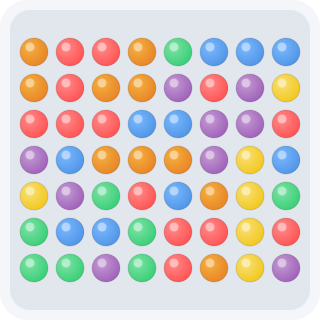

# Match 3 Game

<p align="center">
  
</p>

A modern, feature-rich Match 3 puzzle game with special gems, combo systems, level progression, and more. Enjoy a smooth gaming experience on both desktop and mobile devices.

[中文说明/Chinese Documentation](README.md)

## 🎮 Introduction

Match 3 is a classic puzzle game where players swap adjacent gems to line up three or more gems of the same color, clearing them from the board to score points. It blends strategic thinking with quick reflexes—easy to learn, yet challenging to master.

This project is a modern web implementation of the Match 3 game. It keeps all the fun of the classic gameplay while adding a modern UI, smooth animations, and several enhancements:
- 🎨 Beautiful gem gradients and animations
- 💎 4 types of special gems (striped, wrapped/bomb, rainbow, etc.)
- 🔥 Combo system with cascading clears
- 🏆 5 progressive levels of increasing difficulty
- 🎯 Hint and shuffle boosters to help you clear levels
- 🌓 Light and dark theme support

## ✨ Features

### Core Gameplay
- **8×8 board**: Classic match-3 layout
- **6 colored gems**: Red, blue, green, yellow, purple, and orange, with gradient shine effects
- **Smooth animations**: Silky animations for swapping, clearing, falling, and new gems appearing

### Special Gem System

#### 1. Horizontal Striped Gem (↔)
- **Trigger**: Match 4 gems horizontally
- **Effect**: Clears all gems in the entire row
- **Appearance**: Blue base + white horizontal stripes + ↔ arrow

#### 2. Vertical Striped Gem (↕)
- **Trigger**: Match 4 gems vertically
- **Effect**: Clears all gems in the entire column
- **Appearance**: Purple base + white vertical stripes + ↕ arrow

#### 3. Bomb Gem (💥)
- **Trigger**: Match 5 gems in an L/T shape
- **Effect**: Clears all gems in the surrounding 3×3 area
- **Appearance**: Keeps the original gem color + 💥 icon + golden pulsing glow

#### 4. Rainbow Gem (🌈)
- **Trigger**: Match 5 gems in a straight line
- **Effect**: Clears all gems of the same color on the board
- **Appearance**: Rainbow gradient background with a shimmering animation

### Advanced Systems

#### Combo Bonuses
- **2x combo**: 1.5x score bonus
- **3x combo**: 2x score bonus
- **4x+ combo**: 2.5x score bonus

#### Cascading Clears
- Automatic matches after gems fall into place
- Each cascade triggers a combo bonus

#### Level System (5 Levels)
| Level | Target Score | Moves | Description |
|-------|--------------|-------|-------------|
| 1     | 500          | 30    | 🌟 First Challenge |
| 2     | 1500         | 28    | 🌟🌟 Steady Progress |
| 3     | 2500         | 26    | 🌟🌟🌟 Pushing Limits |
| 4     | 3500         | 24    | 🌟🌟🌟🌟 Road to Mastery |
| 5     | 5000         | 22    | 🌟🌟🌟🌟🌟 Legendary Peak |

**Notes**:
- **Target Score**: The minimum score required to clear the level (must be reached to unlock the next one)
- **Moves**: The number of moves available per level (decreases in later levels, increasing difficulty)

### Booster System
- **Hint**: Highlights a valid swap (limited to 3 uses per level)
- **Shuffle**: Rearranges the board (limited to 1 use per level)

### Theme Support
- **Light theme**: Clean and bright
- **Dark theme**: Easy on the eyes
- Theme toggle button in the top-right corner

## 🎯 Game Rules

1. **Basic operation**: Click a gem, then click an adjacent gem to swap them
2. **Valid swap**: Only swaps that result in 3 or more same-colored gems in a line take effect
3. **Invalid swap**: If no match is formed, the gems automatically bounce back to their original positions
4. **Goal**: Reach the level's target score within the move limit
5. **Level clear**: Reach the target score to advance to the next level
6. **Game over**: Run out of moves without reaching the target score
7. **Completion**: After clearing all 5 levels, a victory celebration page is shown

## 🕹 Controls

### Desktop Controls

| Action | How |
|--------|-----|
| Select a gem | Click a gem |
| Swap gems | Click an adjacent target gem |
| Use a hint | Click the "💡 Hint" button |
| Shuffle | Click the "🔀 Shuffle" button |
| Restart | Click the "🔄 Restart" button |
| New game | Click the "🎮 New Game" button |
| Switch theme | Click the theme toggle button in the top-right corner |

### Mobile Controls

| Action | How |
|--------|-----|
| Select a gem | Tap a gem |
| Swap gems | Tap an adjacent target gem |
| Use a hint | Tap the "💡 Hint" button |
| Shuffle | Tap the "🔀 Shuffle" button |
| Restart | Tap the "🔄 Restart" button |
| New game | Tap the "🎮 New Game" button |
| Switch theme | Tap the theme toggle button in the top-right corner |

## 🧩 Strategy Tips

### Basic Strategies

1. **Prioritize special gems**: Try to form matches of 4 or 5 gems to create powerful special gems
2. **Combine special gems**: Swapping two special gems triggers a combo effect for large-area clears
3. **Start from the bottom**: Clear gems near the bottom first to increase your chances of cascades
4. **Use boosters wisely**: Save hints and shuffles for critical moments—don't waste them

### Advanced Techniques

1. **Striped gem combo**: Swapping two striped gems clears an entire row and an entire column
2. **Precise bomb placement**: Place bombs in dense areas to maximize their clearing power
3. **Rainbow gem strategy**: Use the rainbow gem when many gems of the same color are on the board for high scores
4. **Budget your moves**: When close to the target score, count your remaining moves and avoid unnecessary swaps

## 💻 Technical Implementation

### Frontend Technologies

- **HTML5** - Builds the game interface structure
- **CSS3** - Responsive layout and smooth animations
- **JavaScript (ES6+)** - Core game logic
- **LocalStorage** - Local data persistence

### Core Algorithms

- **Match detection** - Efficiently detects horizontal and vertical matches
- **Clearing algorithm** - Handles regular clears and special gem effects
- **Falling algorithm** - Implements gem falling and refilling with new gems
- **Cascade detection** - Detects cascading clears and combos in real time
- **Hint algorithm** - Intelligently finds valid swaps

### Performance Optimizations

- **CSS animations** - Uses CSS3 hardware acceleration for better animation performance
- **Event delegation** - Reduces the number of event listeners
- **Debouncing** - Optimizes window resizing and touch events
- **Memory management** - Avoids memory leaks and excessive DOM operations

## 📁 Project Structure

```
match3/
├── index.html          # Main page
├── css/
│   └── style.css      # Styles (gem styles, themes, animations, etc.)
├── js/
│   ├── game.js        # Core game logic (board management, match algorithms, clearing, etc.)
│   └── storage.js     # Local storage management (high scores, theme preferences, etc.)
├── README.md          # This file
└── assets/            # Resource files (if any)
```

## 🚀 Installation & Running

### Play Online

Visit the [game homepage](https://blog.huazie.com/diversity/game/match3/) to start playing.

### Run Locally

1. Clone the repository:
   ```bash
   git clone https://github.com/huazie/flea-game.git
   ```

2. Enter the project directory:
   ```bash
   cd flea-game
   ```

3. Open the Match 3 game:
   - Windows: Double-click the `match3/index.html` file
   - macOS: `open match3/index.html`
   - Linux: `xdg-open match3/index.html`

4. Or use a local server (recommended):
   ```bash
   # Run from the project root
   npx http-server -p 8080 --cors
   
   # Then visit in your browser
   # http://127.0.0.1:8080/match3/
   ```

5. Start playing!

## 🌐 Browser Compatibility

| Browser | Support | Minimum Version |
|---------|---------|-----------------|
| Chrome | ✅ Fully supported | 49+ |
| Firefox | ✅ Fully supported | 52+ |
| Safari | ✅ Fully supported | 10+ |
| Edge | ✅ Fully supported | 79+ |
| Opera | ✅ Fully supported | 36+ |
| Chrome for Mobile | ✅ Fully supported | 49+ |
| Safari for iOS | ✅ Fully supported | 10+ |
| Firefox for Mobile | ✅ Fully supported | 52+ |

## 🛠 Development Notes

### Match3Game Class

The core game logic is implemented in the `Match3Game` class, which mainly handles:

- **Initialization**: Sets up the board, score, levels, and event listeners
- **Board generation**: Randomly generates the initial board with no pre-existing matches
- **Click handling**: Handles gem selection and swapping logic
- **Match detection**: Detects valid horizontal and vertical matches
- **Clearing logic**: Handles regular clears and special gem effects
- **Falling logic**: Implements gem falling and refilling with new gems
- **Level management**: Manages level progression, target scores, and move limits
- **Booster system**: Implements the hint and shuffle features
- **Theme switching**: Handles toggling between light and dark themes
- **State management**: Detects game over and level completion
- **UI updates**: Updates the game interface and score display
- **Animation handling**: Implements smooth swap, clear, and fall animations

### GameStorage Class

Data persistence is handled by the `GameStorage` class, which is responsible for:

- **Saving game state**: Stores the current level, high scores, and more in LocalStorage
- **Loading game state**: Restores previous game state from LocalStorage
- **Managing high scores**: Records and updates high scores
- **Clearing data**: Provides a way to clear saved data

## 🐛 Known Issues & Planned Improvements

### Known Issues
- [ ] The hint feature sometimes fails to find a valid swap (algorithm needs improvement)
- [ ] Special gem trigger logic may miss edge cases in complex situations
- [ ] Touch controls on mobile are occasionally unresponsive

### Planned Improvements
- [ ] Add sound effects and background music
- [ ] Add more levels (currently only 5)
- [ ] Support customizable board sizes
- [ ] Add a timed mode
- [ ] Support multiplayer (PvP) mode
- [ ] Add an achievement system

## ❓ FAQ

### How do I get a high score?
Prioritize creating special gems and combine them strategically. Trigger cascades and combos as much as possible to earn score bonuses.

### What happens when I run out of hints?
Hints are limited to 3 uses per level. Once used up, you'll need to spot valid swaps on your own—that's part of the challenge!

### Does shuffling reset the board?
No. Shuffling only rearranges the gems on the board; it doesn't change your score, level progress, or any other game state.

### Is game progress saved?
Yes, the game automatically saves your level progress and high scores. The next time you open the game, it will resume from your previous level.

### How do I switch themes?
Click the theme toggle button in the top-right corner to switch between the light and dark themes.

### What happens after I finish the game?
After clearing all 5 levels, a victory celebration page is displayed. You can click the "🎮 Restart" button to start over from level 1.

### Can I play on mobile devices?
Yes! The game is fully responsive and works great on all kinds of mobile devices.

## 👥 Contributing

We welcome all forms of contribution, including but not limited to:

- Reporting issues and suggestions
- Submitting feature requests
- Code contributions and Pull Requests
- Documentation improvements

Please contribute through GitHub Issues or Pull Requests.

## 📄 License

This project is licensed under the MIT License. For details, see the [LICENSE](../LICENSE) file.
