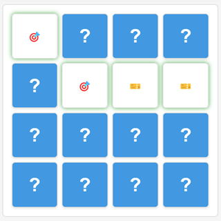

# Memory Match Game

<p align="center">
  
</p>

<p align="center">
  A classic memory match game — train your memory and concentration by pairing identical cards.
  <br>Modern interface design, multiple difficulty levels, and theme switching.
</p>

[中文说明/Chinese Documentation](README.md)

## 🎮 About the Game

Memory Match (also known as the Pairs Game or Concentration) is a classic puzzle game that originated in Europe in the late 19th century. It was originally played with physical cards, and later, with the rise of video games, became one of the classic electronic game genres.

This project is a modern web implementation of Memory Match that keeps the fun of the traditional game while adding a modern UI design, smooth animations, and a number of enhancements. The game is designed to train short-term memory, attention, and focus, and is suitable for players of all ages.

## 📏 Game Rules

1. At the start of the game, all cards are face down
2. You can flip two cards per turn
3. If the two cards match, they stay face up
4. If the two cards don't match, they automatically flip back over
5. The game ends when all cards have been matched
6. Try to finish the game in as few moves and as little time as possible

## ✨ Features

- 🎯 **Multiple difficulty levels**: Easy (4x4), Normal (6x6), Hard (8x8)
- 🌓 **Theme switching**: Light and dark themes to reduce eye strain
- 🏆 **Scoring system**: Move counter, best records, and star ratings
- ⏱️ **Timer**: Tracks elapsed time, saves best times, pause/resume support
- 📊 **Live statistics**: Shows moves, time, progress, and best records
- ✨ **Polished animations**: Smooth card flip and match animations
- 💾 **Auto save**: Saves game progress and best scores
- 📱 **Full device support**: Responsive design, touch-screen optimized, keyboard support

## 🚀 Installation & Running

### Play Online

Visit the [game homepage](https://blog.huazie.com/diversity/game/memory/) to start playing right away.

### Run Locally

1. Clone the repository: `git clone https://github.com/huazie/flea-game.git`
2. Enter the project directory: `cd flea-game`
3. Open the Memory Match game:
   - Windows: double-click the `memory/index.html` file
   - macOS: `open memory/index.html`
   - Linux: `xdg-open memory/index.html`

## 🎯 Controls

### Game Flow

1. **Start the game**: Pick a difficulty level and the game starts automatically
2. **Playing**: Click cards to flip them, two at a time
3. **Game controls**: Restart, pause, and resume the game
4. **Theme switching**: Click the theme toggle button in the top-right corner
5. **Back to home**: Click the back button in the top-left corner

### Input Methods

| Device | Input | Description |
|------|---------|------|
| Mouse | Click | Click a card to flip it |
| Touch screen | Tap | Tap a card to flip it |
| Keyboard | Arrow keys + Space | Select a card and flip it |
| Keyboard | R key | Restart the game |
| Keyboard | P key | Pause/resume the game |
| Keyboard | T key | Switch theme |

## 🧠 Game Tips

### Beginner Tips

1. **Flip systematically**: Flip cards row by row or column by column
2. **Focus and observe**: Concentrate on memorizing card positions
3. **Prioritize**: Go for cards whose positions you've already memorized first
4. **Group memorization**: Memorize cards by grouping them by symbol type

### Advanced Strategies

1. **Memory encoding**: Create memory codes for card positions
2. **Symbol classification**: Mentally group cards with similar symbols
3. **Memory map**: Build a "memory map" of the entire game board
4. **Focus management**: Stay concentrated and avoid distractions
5. **Balancing speed and accuracy**: Find the right balance between speed and accuracy

## 💻 Technical Implementation

### Frontend Technologies

- **HTML5** - Builds the game interface structure
- **CSS3** - Responsive layout and animation effects
- **JavaScript (ES6+)** - Core game logic

### Core Algorithms

- **Fisher-Yates shuffle** - Randomly shuffles the cards
- **Card matching logic** - Handles card flipping and matching
- **Scoring system** - Calculates scores based on moves and time
- **Animation queue** - Manages consecutive animations

### Performance Optimizations

- **Event delegation** - Reduces the number of event listeners
- **CSS animations** - Uses CSS3 hardware acceleration for better animation performance
- **Debouncing** - Optimizes frequent operations
- **Lazy loading** - Optimizes resource loading order

## 📁 Project Structure

```txt
memory/
├── css/              # Stylesheets
├── js/               # JavaScript source code
├── assets/           # Images and icons
├── index.html        # Main game page
└── README.md         # Project documentation
```

## 🌐 Browser Compatibility

| Browser | Support | Minimum Version |
|-------|---------|---------|
| Chrome | ✅ Fully supported | 49+ |
| Firefox | ✅ Fully supported | 52+ |
| Safari | ✅ Fully supported | 10+ |
| Edge | ✅ Fully supported | 79+ |
| Opera | ✅ Fully supported | 36+ |
| IE | ❌ Not supported | - |

## 📱 Mobile Device Support

| Device Type | Support | Notes |
|---------|---------|------|
| iOS devices | ✅ Fully supported | Best experienced on iPhone 6 and above |
| Android devices | ✅ Fully supported | Android 5.0 and above |
| Tablets | ✅ Fully supported | Including iPad and Android tablets |
| Touch-screen laptops | ✅ Fully supported | Both touch and keyboard input supported |

## 🛠 Development Notes

### Main Classes

- **MemoryGame class**: Core game logic, handling card flips, matching, and game state
- **ThemeManager class**: Theme management, handling theme switching and persistence
- **GameStorage class**: Data persistence, saving game state and best records

## ❓ FAQ

### The game is too hard — any tips?
Start with the easy difficulty and use a systematic approach, memorizing card positions row by row or column by column.

### How can I improve my memory?
Play Memory Match regularly and use memory techniques such as the method of loci and visual association.

### Is my game progress saved?
Yes, the game automatically saves your progress and best records.

### How do I switch themes?
Click the theme toggle button in the top-right corner of the game interface.

### How do the keyboard controls work?
Use the arrow keys to select a card and Space to flip it. Press R to restart, P to pause/resume, and T to switch themes.

## 👥 Contributing

All forms of contribution are welcome, including but not limited to:
- Reporting issues and suggestions
- Submitting feature requests
- Code contributions and Pull Requests
- Documentation improvements

Please contribute through GitHub Issues or Pull Requests.

## 📄 License

This project is licensed under the MIT License. See the [LICENSE](../LICENSE) file for details.
