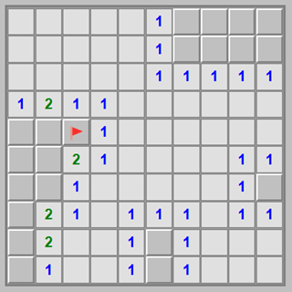

# Minesweeper Game

<p align="center">
  
</p>

<p align="center">
  A classic single-player logic puzzle game that challenges your mind and patience.
  <br>Find hidden mines, flag dangerous areas, and reveal safe zones.
</p>

[中文说明/Chinese Documentation](README.md)

## 🎮 Introduction

Minesweeper is a classic single-player logic puzzle game that first appeared on mainframe systems in the 1960s and became widely known in the 1990s with the popularity of the Windows operating system. Players must deduce the locations of hidden mines through reasoning while avoiding triggering them.

The game's appeal lies in the combination of simple rules and deep strategy. Every round is a unique challenge that calls for logical thinking, probability analysis, and risk management. Minesweeper is not just a casual game—it's also an excellent brain workout.

This project is a modern web implementation of Minesweeper. It preserves all the characteristics of the classic game while adding a modern UI, smooth animations, and several enhancements, making it suitable for players of all ages and skill levels.

## 📏 Game Rules

### Basic Rules

1. **Objective**: Reveal all cells that do not contain mines while avoiding detonating any mine.

2. **Game Board**:
   - The play area consists of a grid of squares
   - Some squares hide mines beneath them
   - Each square can be in one of three states: unrevealed, revealed, or flagged

3. **Number Meanings**:
   - The number on a revealed cell indicates how many mines are among its 8 surrounding cells
   - A 0 means there are no mines nearby (displayed as a blank cell)
   - Numbers 1–8 indicate the corresponding number of adjacent mines

4. **End Conditions**:
   - **Win**: Successfully reveal all cells that do not contain mines
   - **Lose**: Click on a cell containing a mine

### Game Flow

1. The first click is always safe (it will never trigger a mine)
2. Use the numbers on revealed cells to deduce whether neighboring cells contain mines
3. Flag cells that are certain to contain mines
4. Reveal cells that are certain to be safe
5. Repeat steps 2–4 until you win or lose

## ✨ Features

- 🎯 **Multiple difficulty levels**: Beginner (10×10, 10 mines), Intermediate (16×16, 40 mines), Expert (16×30, 99 mines)
- ⏱️ **Game status indicators**: Real-time timer, remaining mine counter, and smiley face button
- 🎨 **Visual feedback**: Cell state change animations, game-over reveal, and incorrect flag warnings
- 🌓 **Theme support**: Light and dark themes
- 🚀 **Smart features**: Auto-expansion of blank areas, double-click quick actions, and first-click protection
- 📱 **Full device support**: Responsive design, touch optimization, and keyboard support

## 🚀 Installation & Running

### Play Online
Visit the [game homepage](https://blog.huazie.com/diversity/game/minesweeper/) to start playing.

### Run Locally
1. Clone the repository: `git clone https://github.com/huazie/flea-game.git`
2. Enter the project directory: `cd flea-game`
3. Open the Minesweeper game: double-click the `minesweeper/index.html` file
4. Start playing!

## 🎯 Controls

### Desktop Controls

| Action | Function |
|--------|----------|
| Left click | Reveal a cell |
| Right click | Flag/unflag a mine |
| Double-click a revealed numbered cell | Quickly reveal surrounding unflagged cells |
| Middle click | Same as double-click |
| Click the smiley button | Restart the game |
| Click a difficulty button | Switch difficulty |
| Click the theme toggle button | Switch between light/dark themes |

### Mobile Controls

| Action | Function |
|--------|----------|
| Tap | Reveal a cell |
| Long press | Flag/unflag a mine |
| Double-tap a revealed numbered cell | Quickly reveal surrounding unflagged cells |
| Tap the smiley button | Restart the game |
| Tap the settings button | Open the settings menu |

### Keyboard Controls

| Key | Function |
|-----|----------|
| Arrow keys | Move the selection focus |
| Spacebar | Reveal the currently selected cell |
| F | Flag/unflag the currently selected cell |
| R | Restart the game |
| 1, 2, 3 | Switch difficulty levels |
| T | Toggle theme |

## 🧠 Strategy Tips

### Basic Techniques

1. **Start from corners and edges**: These positions have fewer neighboring cells, making them easier to reason about
2. **Use the number clues**: Numbers indicate how many mines are among the 8 surrounding cells
3. **Flag confirmed mines**: Prevents accidental clicks and helps you remember
4. **Look for "safe" cells**: If the number of flagged mines around a numbered cell matches its number, the remaining neighboring cells are safe

### Advanced Strategies

1. **1-2 pattern recognition**: Recognize specific number patterns to deduce mine locations
2. **Probability analysis**: Estimate the probability that each unrevealed cell contains a mine
3. **Edge reasoning**: Focus on the boundary between revealed and unrevealed areas

## 💻 Technical Implementation

### Frontend Technologies
- **HTML5** - Builds the game interface structure
- **CSS3** - Responsive layout and animation effects
- **JavaScript (ES6+)** - Core game logic

### Core Algorithms
- **Mine generation** - Random placement that guarantees the first click is safe
- **Auto-expansion** - Automatic flood-fill of blank areas
- **Game state detection** - Real-time detection of win/lose conditions

### Performance Optimizations
- **Event delegation** - Reduces the number of event listeners
- **Batched DOM operations** - Minimizes reflows and repaints
- **Debouncing** - Optimizes frequent operations

## 📁 Project Structure

```txt
minesweeper/
├── css/              # Style files
├── js/               # JavaScript source code
├── index.html        # Game main page
└── README.md         # Project documentation
```

## 🌐 Browser Compatibility

| Browser | Support | Minimum Version |
|---------|---------|-----------------|
| Chrome | ✅ Fully supported | 49+ |
| Firefox | ✅ Fully supported | 52+ |
| Safari | ✅ Fully supported | 10+ |
| Edge | ✅ Fully supported | 79+ |
| Opera | ✅ Fully supported | 36+ |
| IE | ❌ Not supported | - |

## 📱 Mobile Device Support

| Device Type | Support | Notes |
|-------------|---------|-------|
| iOS devices | ✅ Fully supported | Best experience on iPhone 6 and above |
| Android devices | ✅ Fully supported | Android 5.0 and above |
| Tablets | ✅ Fully supported | Including iPad and Android tablets |
| Touchscreen laptops | ✅ Fully supported | Supports both touch and mouse input |

## 🛠 Development Notes

- **MinesweeperGame class**: Core game logic, handling game state and rules
- **GameBoard class**: Manages the board and cell states
- **UIController class**: Handles the user interface and interactions
- **ThemeManager class**: Manages theme switching and persistence

## ❓ FAQ

### How can I improve my Minesweeper skills?
Start with the easy difficulty and learn basic number deduction. As you gain experience, try recognizing common mine patterns. Regular practice is the best way to improve.

### Why is the first click always safe?
This is a deliberate game design feature that ensures players don't lose on their very first move. The mine generation algorithm guarantees that the first-clicked cell and its surroundings contain no mines.

### How do I flag mines on a mobile device?
On mobile devices, long-press a cell to flag/unflag a mine.

### What is the double-click feature for?
When the number of flagged mines around a revealed numbered cell equals its number, double-clicking that cell quickly reveals all surrounding unflagged cells.

### Is there a time limit?
No, there is no time limit, but the game records your completion time. The faster you finish, the better your result.

## 👥 Contributing

We welcome all forms of contribution, including but not limited to:
- Reporting issues and suggestions
- Submitting feature requests
- Code contributions and Pull Requests
- Documentation improvements

Please contribute through GitHub Issues or Pull Requests.

## 📄 License

This project is licensed under the MIT License. For details, see the [LICENSE](../LICENSE) file.
