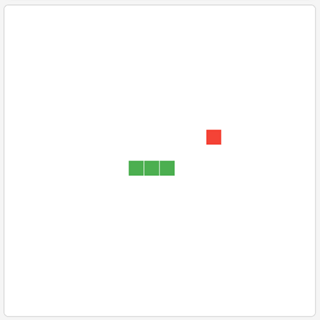

# Snake Game

<p align="center">
  
</p>

A classic Snake game built with modern web technologies, supporting multiple control schemes and theme switching.

[中文说明/Chinese Documentation](README.md)

## 🎮 Introduction

Snake is a classic video game that first appeared in arcade games in 1976 and later gained widespread popularity in 1998 with Nokia mobile phones. The player controls a snake moving within an enclosed space, eating food to grow longer while avoiding collisions with walls or its own body.

This project is a modern web implementation of the Snake game that preserves all the fun of the classic while adding a modern UI, smooth animations, and a number of enhancements. Whether you are on a desktop computer or a mobile device, you can enjoy a fluid gaming experience.

## ✨ Features

- 🎮 **Multiple control schemes**: Keyboard and touch controls to suit different devices
- 🌓 **Theme switching**: Dark/light theme toggle that is easy on the eyes
- 📱 **Responsive design**: Perfectly adapts to screen sizes from phones to desktops
- 💾 **Score records**: High scores are saved automatically so you can challenge yourself
- 🎯 **Live scoring**: Current score and high score displayed at a glance
- 🔄 **Quick restart**: Restart with one click after the game ends
- ⚡ **Smooth animation**: A fluid 60fps gaming experience
- 🔍 **Collision detection**: A precise collision detection system
- 🎨 **Visual feedback**: Clear visual feedback to enhance the gaming experience

## 🎯 How to Play

1. **Basic rules**:
   - Control the snake's movement direction (up, down, left, right)
   - Eating food increases your score and the snake's length
   - Hitting a wall or the snake's own body ends the game
   - Difficulty increases as the snake grows longer

2. **Scoring system**:
   - Each piece of food eaten earns 1 point
   - The score is displayed in real time on the game screen
   - The high score is saved automatically

3. **Game pace**:
   - The game starts at a moderate speed
   - As your score grows, the snake gradually speeds up
   - Challenge your reflexes and strategic thinking

## 🕹 Controls

### Keyboard Controls
| Key | Action |
|------|------|
| ↑ (Up arrow) | Move up |
| ↓ (Down arrow) | Move down |
| ← (Left arrow) | Move left |
| → (Right arrow) | Move right |
| Space | Pause/resume the game |
| R | Restart the game |

### Touch Controls
- On-screen direction buttons let you control the snake's movement
- Swiping up, down, left, or right also changes direction (can be enabled in settings)
- Double-tapping the screen pauses/resumes the game
- The "Restart" button immediately restarts the game

### Theme Switching
- Click the theme toggle button in the upper-right corner to switch between dark and light themes
- Your theme preference is saved automatically and restored the next time you open the game

## 🧠 Game Strategy

### Beginner Tips
1. **Keep your distance**: Maintain a safe distance from your own body
2. **Plan your path**: Map out your route in advance to avoid trapping yourself
3. **Use the edges**: Moving along the borders of the play area reduces the risk of getting trapped
4. **Watch the food**: Adjust your movement strategy based on where the food appears

### Advanced Strategies
1. **Serpentine movement**: Use a zigzag pattern to maximize space utilization
2. **Create paths**: Build spiral or rectangular loops to ensure you always have a way out
3. **Look ahead**: Anticipate the situation several moves ahead to avoid dead ends
4. **Adapt to speed**: As the game speeds up, adjust your reaction time and decision-making pace

## 🚀 Installation & Running

### Play Online
Visit the [game homepage](https://blog.huazie.com/diversity/game/snake/) to start playing

### Run Locally
1. Clone the repository:
   ```bash
   git clone https://github.com/your-username/flea-game.git
   ```

2. Enter the project directory:
   ```bash
   cd flea-game
   ```

3. Open the Snake game:
   - Windows: double-click the `snake/index.html` file
   - macOS: `open snake/index.html`
   - Linux: `xdg-open snake/index.html`

## 💻 Technical Implementation

### Frontend Technologies
- **HTML5 Canvas** - Renders the game graphics and animations
- **CSS3** - Responsive layout and theme switching
- **JavaScript (ES6+)** - Game logic and controls
- **LocalStorage** - Local data persistence

### Core Algorithms
- **Snake movement** - Uses an array to simulate the snake's body and implement movement
- **Collision detection** - Detects collisions with food, walls, and the snake's own body
- **Food generation** - Randomly spawns food, ensuring it never overlaps with the snake
- **Game loop** - Uses requestAnimationFrame for a smooth game loop

### Performance Optimizations
- **Frame rate control** - Maintains a stable 60fps experience
- **Event delegation** - Reduces the number of event listeners
- **Caching strategy** - Caches game elements to avoid redundant computation
- **Throttling** - Optimizes touch and keyboard input handling
- **Memory management** - Prevents memory leaks and excessive DOM operations

## 📁 Project Structure

```
snake/
├── css/
│   └── style.css      # Responsive styles and theme definitions
├── js/
│   ├── game.js        # Core game logic
│   ├── storage.js     # Storage management (high score, settings)
│   └── touch-controls.js # Touch control implementation
├── index.html         # Main game page
└── README.md          # Project documentation
```

## 🌐 Browser Compatibility

| Browser | Support | Minimum Version |
|-------|---------|---------|
| Chrome | ✅ Fully supported | 49+ |
| Firefox | ✅ Fully supported | 52+ |
| Safari | ✅ Fully supported | 10+ |
| Edge | ✅ Fully supported | 79+ |
| Opera | ✅ Fully supported | 36+ |
| IE | ❌ Not supported | - |

## 📱 Mobile Device Support

| Device Type | Support | Notes |
|---------|---------|------|
| iOS devices | ✅ Fully supported | Best experienced on iPhone 6 and above |
| Android devices | ✅ Fully supported | Android 5.0 and above |
| Tablets | ✅ Fully supported | Including iPad and Android tablets |
| Touchscreen laptops | ✅ Fully supported | Supports both touch and keyboard controls |

## 🛠 Development Notes

### The SnakeGame Class

The core game logic is implemented in the `SnakeGame` class, which mainly handles:

- **Initialization**: Sets up the game canvas, snake, food, and event listeners
- **Game loop**: Controls game updates and rendering
- **Collision detection**: Detects collisions with food, walls, and the snake's own body
- **Food generation**: Spawns food at random positions
- **Score management**: Updates and displays the score
- **Game state**: Manages the started, paused, and game-over states

### The TouchControls Class

Mobile touch controls are handled by the `TouchControls` class, which is responsible for:

- **Touch events**: Listening for and processing touch events
- **Direction control**: Translating touches into directional input
- **Gesture recognition**: Recognizing swipes and taps
- **Virtual buttons**: Implementing on-screen virtual control buttons

### The GameStorage Class

Data persistence is handled by the `GameStorage` class, which is responsible for:

- **Saving the high score**: Stores the high score in LocalStorage
- **Loading the high score**: Reads the high score from LocalStorage
- **Theme settings**: Saves and loads theme preferences
- **Game settings**: Manages other game settings

## ❓ FAQ

### Does the game get faster over time?
Yes. As the snake grows longer, the game speed gradually increases, adding to the challenge.

### How do I get the best experience on a mobile device?
We recommend using your device in landscape orientation for a larger play area. You can also enable swipe controls in the settings for more intuitive handling.

### Does the game save my high score?
Yes. The game automatically saves your high score to the browser's local storage. Even after closing the browser, your high score will still be there the next time you open the game.

### Why does my snake sometimes change direction unexpectedly?
This may happen if you press multiple arrow keys in rapid succession. The game processes only one direction change per frame, so pressing several keys within a single frame can cause unexpected turns.

### How do I switch themes?
Click the theme toggle button in the upper-right corner of the game screen to switch between dark and light themes.

## 👥 Contributing

We welcome contributions of all kinds, including but not limited to:

- Reporting issues and suggestions
- Submitting feature requests
- Code contributions and Pull Requests
- Documentation improvements

Please participate via GitHub Issues or Pull Requests.

## 📄 License

This project is licensed under the MIT License. For details, see the [LICENSE](../LICENSE) file.
