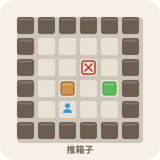

# Sokoban (推箱子)

<p align="center">
  
</p>

A classic Sokoban puzzle game: move the worker and push all boxes onto the target spots to clear a level. Pure frontend implementation (HTML5 + CSS3 + vanilla JavaScript) with zero dependencies — ready to run out of the box.

[中文说明/Chinese Documentation](README.md)

## ✨ Features

- 🎮 **Classic gameplay**: push boxes on a grid; clear the level once all boxes are on targets. The player, boxes, and targets all have distinct icons (worker / box / box + ❌; SVG vectors scale with the grid)
- 🗺️ **Four-page structure**: Home → Game / Level Viewer / Level Editor, with cross-navigation and back links
- 🧩 **Built-in levels**: 10 official levels from easy to hard, all verified solvable by a BFS solver before release
- ↩️ **Undo / Reset**: step-by-step undo and one-click reset for the current level
- 🔢 **Level navigation**: freely switch between previous/next levels; best move counts are recorded per map fingerprint (game notation), so they stay intact even if levels are reordered
- 💾 **Progress saving**: progress and best move counts are stored in LocalStorage
- 🔀 **Merged level pool**: every entry point (Start Game / floating panel / trial play) loads the merged "official + custom" level pool, so sequential switching never skips a level
- 🌓 **Theme switching**: light / dark themes, consistent with the whole site
- 📱 **Full responsiveness**: responsive layout with arrow keys on desktop / swipe gestures on mobile; the mini-map and secondary actions are automatically hidden on phones for a shorter page
- 🖌️ **Level editor**: drag to draw (continuous drawing), adjustable rows/columns, one-click clear / load sample, live mini-map preview, and BFS solvability verification
- 📂 **Custom levels**: supports configuration-based per-level overrides of built-in levels, as well as uploading local level files for trial play
- 👀 **Level viewer**: mini-map cards for official/custom levels with trial play, sharing, export / batch export, and deletion, plus "unsolvable" warnings
- 🔍 **Level search**: real-time filtering by level name within the "Default" and "My Levels" sections
- 🔗 **Share & import**: one-click copy of a share link (base64-encoded) — friends who open it get the level imported automatically
- 📤 **Level export**: each card can be exported as JSON (with name and map) or TXT (pure ASCII art)
- 📦 **Batch export**: on the Level Viewer page, "My Levels" can be exported all at once, or only the levels matching the current search (the export filename automatically includes the search term) as a single JSON bundle
- 💬 **Comment system**: all four pages integrate the site-wide comment drawer (floating button)

## 📄 Pages

| Page | File | Description |
|------|------|------|
| Home | `index.html` | Three entry cards: "Start Game / View Levels / Create Levels" |
| Game | `game.html` | Play levels, undo / reset, previous / next level, upload for trial play, win/lose screen |
| Level Viewer | `levels.html` | Mini-map cards: trial play / share / export / batch export / delete, upload & import, search |
| Level Editor | `editor.html` | Draw the board by dragging; verify solvability, then save / trial play |

## 🕹 Controls

| Platform | Controls |
|------|------|
| Desktop | Arrow keys or WASD to move; Z to undo |
| Mobile | Swipe on the board to move |
| Level Editor | Hold and drag with mouse / finger to draw continuously; switch tools (wall / floor / target / box / player / eraser) in the toolbar |

## 📁 Project Structure

```
sokoban/
├── index.html              # Home page
├── game.html               # Game page
├── levels.html             # Level viewer page
├── editor.html             # Level editor page
├── config/
│   ├── sokoban-levels.json # Built-in levels (supports per-level overrides)
│   └── levels-manifest.json# Level manifest (drives loading; signature check with auto refresh)
├── css/
│   ├── home.css            # Home page styles
│   ├── style.css           # Game page styles (light/dark theme variables, SVG mask icons)
│   ├── levels.css          # Level viewer page styles
│   ├── levelpicker.css     # Floating level picker panel styles
│   └── editor.css          # Level editor page styles
├── js/
│   ├── game.js             # Game core (movement / pushing / undo / win-loss / control bar / merged level pool)
│   ├── levelpicker.js      # Floating level picker panel (merged official + custom pool, current-level highlight, in-place switching)
│   ├── levels.js           # Level data loading & parsing (JSON / ASCII art)
│   ├── solver.js           # BFS solvability solver
│   ├── map.js              # Shared mini-map rendering
│   ├── storage.js          # Local storage (best move counts per map fingerprint / progress)
│   ├── userlevels.js       # User level CRUD + base64 share codes + export / batch export
│   ├── viewer.js           # Level viewer page logic (cards / search / cache / batch export)
│   ├── editor.js           # Level editor page logic (drawing / verification / saving)
│   └── home.js             # Home page navigation
└── README.md
```

## 🧩 Level Character Convention

Levels are described as ASCII maps:

| Character | Meaning |
|------|------|
| `#` | Wall |
| `(space)` | Floor |
| `.` | Target spot |
| `$` | Box |
| `*` | Box already on a target spot |
| `@` | Player |
| `+` | Player standing on a target spot |

Both built-in levels and user-created levels are verified solvable by the BFS solver, avoiding dead ends.

## 📂 Custom Levels

### 1. Configuration-based (per-level overrides)

In `sokoban/config/sokoban-levels.json`, only write the levels you want to adjust. They **override the corresponding built-in levels by index**, and unlisted ones keep the defaults:

```json
{
  "levels": [
    { "name": "My Level 1", "map": ["####", "#@ #", "#$ #", "# .#", "####"] },
    { "name": "My Level 2", "map": ["####", "#@ #", "####"] }
  ]
}
```

> This overrides only levels 1 and 2; the remaining levels keep the built-in defaults. Entries beyond the built-in range are ignored (to add new levels, use the "Level Editor" or "Upload for Trial Play").

### 2. Create Levels

Go to the "Create Levels" page and draw by dragging: pick an element from the toolbar (wall / floor / target / box / player / eraser), then hold and drag on the canvas to draw continuously. You can adjust rows/columns, clear everything, or load a sample with one click. Once done, click "Verify Solvable" to check it with the BFS solver; after it passes, "Save" it to "My Levels" or go straight to "Trial Play".

### 3. Upload for Trial Play

On the Game page or Level Viewer page, click "**Upload Level**" and pick a local file to try it out right in the browser — this does not affect built-in progress or best records. During trial play the level name is shown as "`Custom · Level Name`"; use the back arrow at the top to return to the page you came from.

Two file formats are supported (auto-detected):

- **JSON**
  - Single level: `{ "name": "Level name", "map": ["row1", "row2", ...] }`
  - Multiple levels: `{ "levels": [ { "name": "Level 1", "map": [...] }, ... ] }`
- **Plain-text ASCII art**: each line is one row of the ASCII map (same character convention as above)

> While parsing, invalid characters are filtered into floor (spaces), and rows of unequal length are right-padded with spaces for a forgiving trial-play experience.

## 🔗 Share & Import

- **Share**: click "Share" on any card in the Level Viewer; the level is base64-encoded into an `editor.html?import=...` link and copied to the clipboard.
- **Import**: when a friend opens the link, the level is imported into "My Levels" automatically. You can also paste a share code / link on the Level Viewer page and click "Import Share".
