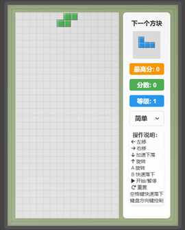

# Tetris

<p align="center">
  
</p>

<p align="center">
  A classic puzzle game that challenges your spatial thinking and reflexes.
  <br>Rotate, move, and clear lines — experience the endless charm of the tetromino world.
</p>

[中文说明/Chinese Documentation](README.md)

## 🎮 Introduction

Tetris is a classic puzzle game invented by the Russian engineer Alexey Pajitnov in 1984. It was originally developed on an Electronika 60 computer and later popularized worldwide by Nintendo in 1989, becoming one of the most beloved video games of all time.

The name "Tetris" comes from the Greek prefix "tetra-" (meaning "four") and Pajitnov's favorite sport, tennis. It reflects the fact that every tetromino in the game is made up of four small squares.

Tetris's appeal lies in being "easy to learn, hard to master." The basic rules are simple and clear, but reaching a high level demands strategic thinking, spatial imagination, and quick reflexes. It is more than just a game — it is a global cultural phenomenon that has influenced countless later game designs.

This project is a modern web implementation of Tetris that preserves the classic core gameplay while adding a modern UI, multi-platform support, and rich game features, delivering a smooth and immersive experience for players.

## ✨ Features

- 🧩 **Core gameplay**: Classic mechanics, next-piece preview, statistics panel, multiple difficulty levels
- 🎨 **UI & interaction**: Responsive design, theme switching, animations, visual feedback, sound effects
- 🎛️ **Input support**: Keyboard controls, touch controls, virtual buttons, game controls, custom key bindings
- 💾 **Data features**: Local storage, game statistics, achievement system

## 🚀 Installation & Running

### Play Online
Visit the [game homepage](https://blog.huazie.com/diversity/game/tetris/) to start playing

### Run Locally
1. Clone the repository: `git clone https://github.com/huazie/flea-game.git`
2. Enter the project directory: `cd flea-game`
3. Open the Tetris game: double-click the `tetris/index.html` file
4. Start playing!

## 📏 Game Rules

### Basic Rules

1. **Objective**: Rotate and move the falling tetrominoes to form complete horizontal rows, clearing them to earn points.

2. **Tetromino types**:
   - I-tetromino (bar): a straight line of 4 squares
   - O-tetromino (square): a 2×2 square
   - T-tetromino: a row of 3 squares plus 1 centered below
   - L-tetromino: a row of 3 squares plus 1 on the right
   - J-tetromino: a row of 3 squares plus 1 on the left
   - S-tetromino: a zigzag shape (leaning upper-right)
   - Z-tetromino: a zigzag shape (leaning upper-left)

3. **Game flow**:
   - Tetrominoes appear at random at the top of the screen and fall
   - The player can move them left/right and rotate them
   - A tetromino locks in place when it lands on the bottom or on other tetrominoes
   - When a row is completely filled, it is cleared
   - When the stack reaches the top of the screen, the game is over

### Scoring Rules

| Action | Points |
|------|------|
| Clear 1 line | 100 × current level |
| Clear 2 lines | 300 × current level |
| Clear 3 lines | 500 × current level |
| Clear 4 lines (Tetris) | 800 × current level |
| Soft drop (down arrow) | 1 point per cell |
| Hard drop (space) | 2 points per cell |

### Difficulty Settings

- **Easy**: Slow initial fall speed, slow level progression
- **Normal**: Moderate initial fall speed, normal level progression
- **Hard**: Fast initial fall speed, faster level progression

### Level System

- The level increases by 1 for every 10 lines cleared
- Leveling up increases the fall speed of tetrominoes
- The maximum level is 15

## 🧠 Game Tips

### Basic Tips

1. **Keep it flat**: Keep the bottom of the play area as flat as possible and avoid creating "holes"
2. **Plan ahead**: Watch the "next piece" preview and reserve suitable spots for upcoming tetrominoes
3. **Use the I-tetromino wisely**: Reserve vertical space for the I-tetromino (bar) to clear multiple lines at once
4. **Master the hard drop**: Hard-drop as soon as the placement is decided to save time and earn bonus points

### Advanced Strategies

1. **T-Spin technique**: Learn to rotate the T-tetromino in tight spaces to solve seemingly impossible situations
2. **4-line clear (Tetris)**: Aim to clear 4 lines at a time whenever possible for the highest score
3. **Wall-side building**: Stack tetrominoes against one wall, leaving a well for the I-tetromino
4. **Quick recovery**: When the board turns unfavorable, learn to recover fast by prioritizing clears near the top

## 💻 Technical Implementation

### Frontend Technologies
- **HTML5** - Builds the game interface structure
- **CSS3** - Responsive layout and animation effects
- **JavaScript (ES6+)** - Core game logic
- **Canvas API** - Game rendering
- **Web Audio API** - Sound effect processing
- **LocalStorage** - Data persistence

### Core Algorithms
- **Tetromino generation** - The 7-bag randomizer ensures a fair distribution
- **Collision detection** - Checks the validity of tetromino moves and rotations
- **Line clearing** - Detects and processes the clearing of complete rows
- **SRS rotation system** - The Super Rotation System, handling edge cases in tetromino rotation

### Performance Optimizations
- **Canvas optimization** - Reduces the number of repaints
- **Event throttling** - Optimizes key and touch event handling
- **Resource preloading** - Loads image and audio assets in advance
- **State management** - An efficient game state update mechanism

## 📁 Project Structure

```txt
tetris/
├── css/              # Style files
├── js/               # JavaScript source code
├── assets/           # Game assets (images, sounds)
├── index.html        # Main game page
└── README.md         # Project documentation
```

## 🌐 Browser Compatibility

| Browser | Support | Minimum Version |
|-------|---------|---------|
| Chrome | ✅ Fully supported | 49+ |
| Firefox | ✅ Fully supported | 52+ |
| Safari | ✅ Fully supported | 10+ |
| Edge | ✅ Fully supported | 79+ |
| Opera | ✅ Fully supported | 36+ |
| IE | ❌ Not supported | - |

## 📱 Mobile Device Support

| Device Type | Support | Notes |
|---------|---------|------|
| iOS devices | ✅ Fully supported | Best experienced on iPhone 6 and above |
| Android devices | ✅ Fully supported | Android 5.0 and above |
| Tablets | ✅ Fully supported | Including iPad and Android tablets |
| Touchscreen laptops | ✅ Fully supported | Supports both touch and keyboard controls |

## 🛠 Development Notes

### Main Classes

- **TetrisGame class**: Core game logic, handling game state and rules
- **BoardRenderer class**: Renders the game interface
- **InputHandler class**: Handles keyboard and touch input
- **AudioManager class**: Manages game sound effects
- **ScoreManager class**: Handles score calculation and records

## ❓ FAQ

### How do I improve my score?
Focus on clearing multiple lines at once (especially a 4-line Tetris), use hard drops for bonus points, and maintain an efficient stacking strategy.

### Is game data saved?
Yes. The game automatically saves your high score and settings preferences to the browser's local storage.

## 👥 Contributing

We welcome contributions of all kinds, including but not limited to:
- Reporting issues and suggestions
- Submitting feature requests
- Code contributions and Pull Requests
- Documentation improvements

Please participate via GitHub Issues or Pull Requests.

## 📄 License

This project is licensed under the MIT License. For details, see the [LICENSE](../LICENSE) file.
